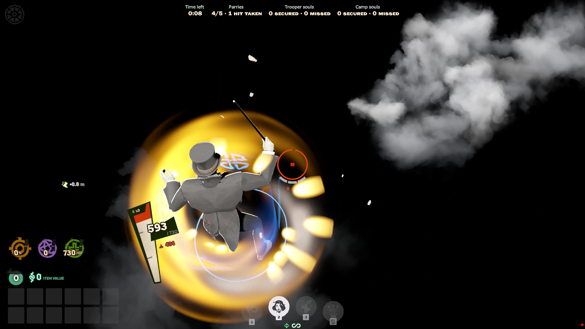
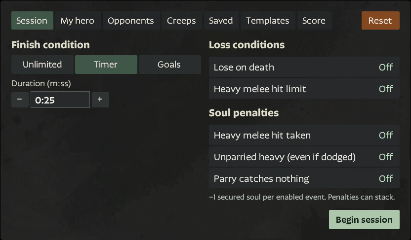
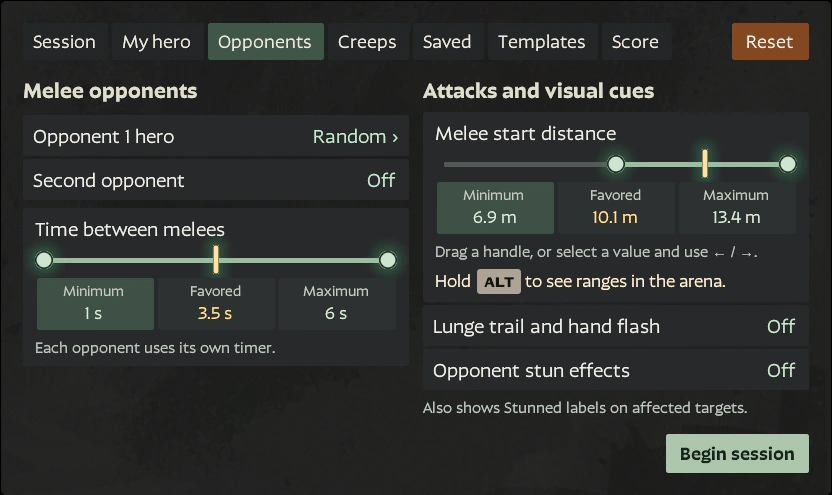
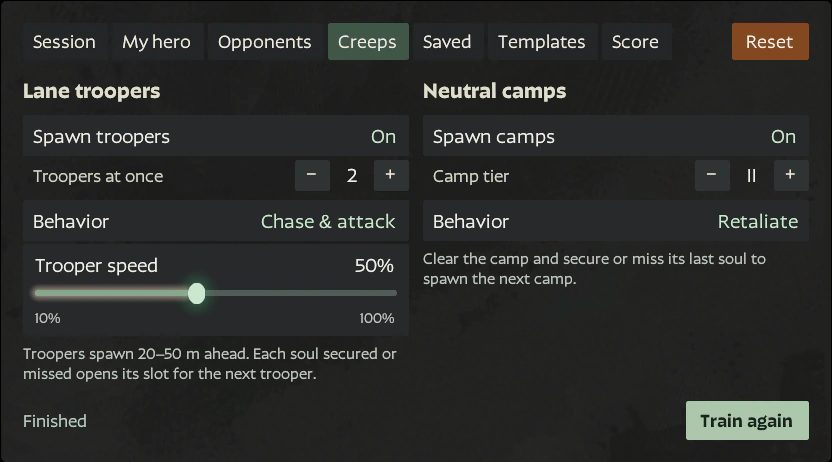
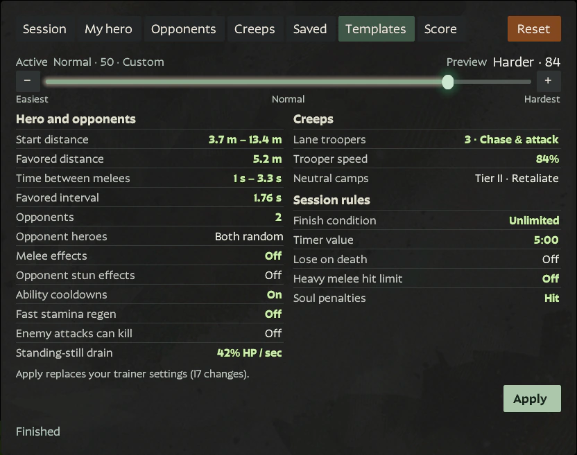
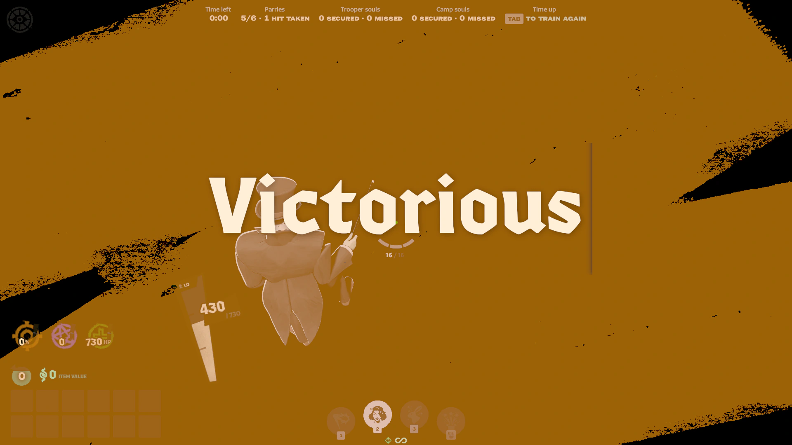
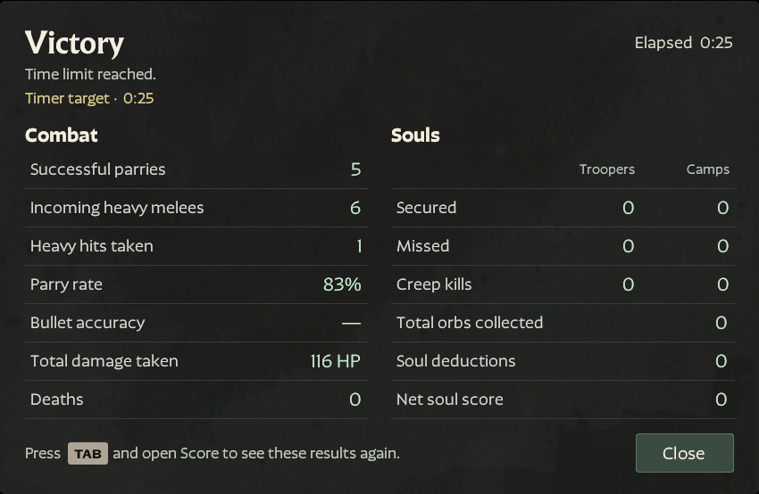

# Parry Trainer

A solo Deadlock training mode for Windows and Linux. Stand still, run, shoot or jump in a black arena. A hidden enemy hero periodically starts a real heavy melee from within reach, follows your movement through the windup and lunge, and can catch a late dodge. Deadlock decides each hit and parry. You hear the melee cue and can move and shoot through the attacker. Turn on lane troopers or neutral camps to practice fighting and securing souls while the same hidden opponent keeps throwing heavies.

## Play

Parry Trainer 0.4.4 is available for local play while Hyperline publication is pending. Play on Windows or Linux with Steam, Deadlock and [Modlock v0.1.112](https://github.com/paralin/modlock/releases/tag/v0.1.112).

1. Download the [trainer ZIP](https://github.com/mapleroyal/parry-trainer/raw/refs/heads/main/dist/parry-trainer-0.4.4-hyperline.zip) and extract it into a fresh folder.
2. Close Deadlock and finish any queued Deadlock update in Steam Downloads. Leave Steam running. The local host and game share files, so applying a patch during practice can disconnect you.
3. Run `modlock play --watch=false "<extracted folder>"`. Choose the folder containing `mod.json`.

The ZIP above is the last packaged build. To try the script-free source version, set `MODLOCK_CLI` and `MODLOCK_HOST` to matching builds with the [typed menu and document controls](https://github.com/paralin/modlock/pull/184). Then run `bin/hyperline play` on Linux or `py -3 bin/hyperline play` on Windows. Quit Deadlock when finished, then press Ctrl+C in the terminal if the host is still running. Audio uses your game volume.

## Release screenshots

These show the packaged release above.



*Sinclair parries a fourth heavy melee with eight seconds left on the timer.*

| Session | Opponents |
| --- | --- |
| <a href="docs/screenshots/session.webp"></a> | <a href="docs/screenshots/opponents.webp"></a> |

| Creeps | Templates |
| --- | --- |
| <a href="docs/screenshots/creeps.webp"></a> | <a href="docs/screenshots/templates.webp"></a> |

| Victorious | Final scorecard |
| --- | --- |
| <a href="docs/screenshots/victorious.webp"></a> | <a href="docs/screenshots/scorecard.webp"></a> |

## Training

You enter a quiet arena with a randomly selected hero. Press the scoreboard key (Tab by default) to open **Session**. Between sessions, press it again to close the menu. Choose your rules, then select **Begin session**. During the countdown and practice, hold the scoreboard key to open the menu and release it to aim. Escape also closes the menu, including while typing a save name.

The **Templates** tab, just before **Score**, offers built-in configurations. Move the slider from **Easiest** to **Hardest** to preview a template, then choose **Apply**. Use **Saved** for drills you create yourself. **My hero** controls cooldowns, stamina, health and leveling. **Opponents** controls the hidden attackers and their cues. **Creeps** controls lane troopers and neutral camps. To switch your own hero, use Deadlock’s **Escape → Swap Hero**, including during a session.

The trainer remembers your options between launches. **Reset** at the bottom of the menu restores all trainer options to Normal, including random opponents and unlimited practice. Your equipped hero, purchases, saved entries and score are kept. Using Reset during practice lets you continue the same session with the default rules.

In **Session**, choose **Unlimited**, a **Timer**, or **Goals**. Goals can require successful parries, souls, or both. A zero leaves that target out. Choose **Set** to accept an edited number, or **Begin session** to accept it and start. Duration accepts seconds or `m:ss`. The top row shows elapsed time, parries, heavy hits taken, and souls secured or missed from each creep source. A timer replaces elapsed time with time remaining. The clock starts after the countdown and freezes at the result.

Survive the timer or reach all your goals to win. Reaching the heavy-hit limit or dying with **Lose on death** enabled ends the session in defeat. Both outcomes show a brief result banner and play matching music before opening the scorecard. The Score tab and final scorecard show bullet accuracy as both a percentage and hits out of pellets fired. Hits on troopers, neutrals and soul orbs count. Accuracy has no effect on the outcome. Modlock reports pellet contacts without individual projectile IDs, so overlapping piercing shots can give an approximate result. The final score stays open until you select **Close** or press Escape. Press the scoreboard key and open **Score** to revisit it. Ending a session manually also keeps its score there. Beginning another session clears the counters.

**Session → Soul penalties** has three independent switches. Each enabled event can deduct one collected soul from your training score.

- A heavy melee hits you.
- A heavy melee goes unparried, including a heavy you dodge.
- You activate parry and it catches nothing. Pressing the key during cooldown costs nothing.

The deductions stack and stop at zero. A melee auto-secure or a shot orb each adds one. Soul goals use the net score. The **Score** tab shows raw collections and misses by source, deductions, net souls, deaths, and actual HP lost to attacks and standing still. Buying items and respawning do not spend or restore scored souls. To switch creep sources during a session with a soul goal, enable the new source first.

### Save, load and back up

In **Saved → Drills**, choose **Save drill** to name a set of trainer options. Turn on **Include [hero] build** to attach your current inventory, level and abilities. **Load drill and build** switches to the saved hero and equips its build. **Load drill only** keeps your current hero and build.

**Overwrite** updates a named drill with your current session settings. It also refreshes an attached build when you’re playing its hero. On another hero, the drill keeps the attached build.

Drills saved with the older single distance slider adopt the new bounds when their distance matched the template. A custom fixed near or far distance stays fixed at that end. Other custom distances retain the full range and translate the old weighting to the new control. Existing drills and saved settings keep their original timing. Drills from before timing was adjustable keep the original 1.9–6 second range, with the midpoint favored.

In **Saved → Hero builds**, choose **Save build** to save inventory, abilities, or both for your current hero. Inventory includes items, active slots and imbues. Abilities include upgrades, level and unspent points. **Load build** switches to the saved hero and restores the selected parts. While playing that hero, use **Overwrite** to update the build. You can also rename or delete it.

In Hyperline, **Saved → Backups → Export backup** puts the settings, drills and builds into a text field. Copy its contents to a file such as `parry-trainer.json`. To restore or transfer it, paste the JSON into the import field between sessions, choose **Review import** and confirm. A complete, valid import replaces the account library and settings together.

Hyperline stores the library for the signed-in player. Let **Saving** finish before leaving if you want the latest changes to follow you. When account storage is offline you can still practice and change the session settings. The client reports storage errors and preserves the saved library. The account record fits up to 7,500 bytes of packed trainer data; capacity depends on the drills and hero builds. To move your saved drills from an earlier trainer installation, export there and import the JSON here.


### Shop and abilities

Use **B** anywhere to buy or sell items with Sandbox funds and open the native build browser. Your inventory shows the value of equipped items. Use your usual bindings to learn, upgrade and cast hero abilities or activate purchased items, including in parry-only sessions. **Max level** grants level 36 and its ability points. Each session starts with full health, ammo and stamina, replenished skill charges, and ready ability and item cooldowns. Your equipped build and skill upgrades carry over.

| Setting | Starts at | What it changes |
| --- | --- | --- |
| Melee start distance | 6.9–13.4 m, favoring 10.1 m | In **Opponents**, adjust the minimum, favored and maximum values. Between sessions, choose **Show range rings** to see the distances in the arena. Equal distances share a ring. Set both limits equal to drill one distance. |
| Time between melees | 1–6 s, favoring 3.5 s | Each opponent rolls its own time between windups. In **Opponents**, set the shortest, longest and favored waits. Set the limits equal for a steady rhythm. |
| Ability cooldowns | Off | Uses the Sandbox cooldown cap. Turn on for the usual penalty after a missed parry. |
| Fast stamina regen | On | Uses the built-in Sandbox setting. Turn off for normal stamina recovery. |
| Opponent melee effects | Off | Show the opponent’s hand flash, lunge dust and sprint trails together. |
| Parry effects and stun labels | Off | Show the orbiting star and sparks on parried opponents. The stock HUD still owns its stun labels and player feedback. |
| Opponent 1 hero | Random | Open the list and click a hero to change whose melee you hear and practice against. |
| Second opponent | Off | Enable an independently timed attacker. Its hero can be selected separately. |
| Lose on death | Off | Turn on to end the session on any death, including a standing-still death. Leave it off to respawn at full health after about 1.5 seconds and continue the same session. The refill includes health from items. Movement, firing and standing-still damage resume when your hero returns to play. |
| Heavy melee hit limit | Off | Before starting, choose how many incoming heavy melees you can take (1–9999, initially 3). The HUD tracks progress. Taking the selected hit ends the session. Parries and creep damage do not count. |
| Standing still drains health | On at 25% per second | While standing still during a session, you lose a percentage of maximum health each second. The **DON'T STAND STILL** warning appears when the drain takes health. Movement stops the drain. While you parry, the trainer holds the cost until the guard resolves. Catch a melee and that guard costs no health. Miss and the trainer applies the health cost for the time you stood still. The drain can kill you even with enemy damage protection. You can toggle the drain and adjust its rate from 15% to 50% in **My hero**. |
| Enemy attacks can kill | Off | Turn on to allow lethal damage from enemies. When off, Sandbox protects you against lethal enemy attacks. The standing-still drain and the consequence of dying each have a separate switch. |
| Lane troopers | Off | Choose 1–4 simultaneous troopers. Each new trooper appears 20–50 m ahead in a random direction within the forward arc. Choose stationary targets or active troopers that pursue and fire. A defeated trooper’s slot refills once its soul resolves. |
| Trooper speed | 50% | Scales active trooper movement from 10% to 100% of the previous trainer speed. Adjust it during a session to change the speed of troopers already in the arena. |
| Neutral camps | Off | Choose tier I, II or III. Choose stationary neutrals or ones that retaliate when attacked. One of 35 Midtown formations spawns at a time. The next camp waits for the last neutral and outstanding souls. Half the neutral bounty goes into a shootable soul for this drill. |

### Templates

The default template is **Normal (50)**. Moving the slider previews the melee, hero, creep and session settings for another template and enables **Apply**. Moving the slider does not change your current settings. The preview changes the drill only after you confirm **Apply template**.

Applying a template replaces the trainer options, selects random opponents and sets the finish condition to Unlimited. Your equipped hero and saved drills are kept. Select **Begin session** to start with the settings currently in effect.

Every template keeps the same maximum melee distance. **Easiest (0)** fixes every start at 13.4 m and shows the opponent’s lunge and stun effects. **Normal (50)** uses the far half of the range, from 6.9 to 13.4 m, and favors its midpoint at 10.1 m. Above Normal, both the minimum and favored distance move closer. Template 99 still leaves 2.4 m of separation. **Hardest (100)** opens the full 0.25–13.4 m range and favors point blank. About one in eight of its punches still starts beyond the halfway point.

Distance is measured between the heroes at the start of the windup. The maximum is a stock heavy started from rest on level ground, pressing forward and melee together. In Deadlock build 6865, the trainer hit a stationary target at 529.4 Source units (13.45 m) and missed at 529.5. The target’s collision shape gives diagonal approaches a little extra reach, so the trainer uses a reachable heading for long punches. A running start, dash or movement after the windup changes the distance a punch can cover in a match.

**Harder** templates introduce pursuing troopers, stronger camps, standard stamina and cooldowns, and a second attacker as the slider rises. The heavy-hit soul penalty starts at 70, the unparried-heavy penalty at 85, and the empty-parry penalty at 100. Later steps also introduce a hit limit and let enemy attacks kill you. **Hardest (100)** enables losing on any death and sets a one-hit limit.

Standing-still damage is off at Easiest. It starts at 15% of maximum health per second at 1, reaches 25% at Normal and 50% at Hardest. After applying a template, you can fine-tune any setting on its own tab. The options for troopers, camps and other toggles appear when enabled. Switching them off keeps their values for later.

Easiest spaces windups 5–6 seconds apart and favors 5.75 seconds. Hardest narrows the interval to 1–2 seconds and favors 1.25 seconds. When the limits differ, each exact endpoint occurs roughly once in forty rolls. A stunned opponent still has to recover before starting another windup.

The arena recenters you before you can reach its edges and carries your height, facing, velocity, and any attacking opponents along. Downward shots hit the floor where you aim. Shots into open air can travel to the weapon’s normal range. The score page tallies incoming heavy swings, parries and hits, plus souls secured and missed separately for troopers and camps.

## Build the Hyperline release

Install a matching Modlock CLI and host with typed menus and document controls, and Python 3.11 or later on the development machine. Put `modlock` on PATH or point `MODLOCK_CLI` at the executable. From a prepared checkout, the script can also use the pinned CLI at `.runtime/hyperline/modlock`.

```sh
bin/hyperline build
bin/hyperline verify
```

The first command writes the mod-only ZIP in `dist/`. It includes the compiled gameplay, arena, menu and range markers. The second runs Modlock's publication checks against a temporary local archive. It can download the SDK's Windows CLI for that check. Neither command starts Deadlock or publishes the mod.

`native/main.ts` starts the hosted mode. Combat, creep behavior, scoring and hero loadouts live in the top-level TypeScript modules. `native/interface.ts` draws the trainer with typed Modlock controls. Modlock owns client input and focus, and delivers a completed backup to the server for validation before the player confirms replacement. The map builds from authored entities, physics, world resources and navigation. Its sky and the range markers' textures resolve from the player's installed game.

To run the backup and gameplay-state tests with Node 24 or later, use `node --test tests/*.mjs`.

For a dedicated-server check, `bin/hyperline probe-build cues` builds the stock-melee probe in `.runtime/hyperline/probes/cues`. Run the pinned CLI with `modlock play --no-game --watch=false .runtime/hyperline/probes/cues` and look for `PARRY TRAINER PROBE PASS`. The `quiet-melee` probe checks weapon selection and restoration across the playable roster. The `open-arena` probe checks the floor and long-range bullet travel. The `session`, `tracking`, `melee-distance`, `parried`, `respawn` and `hero` probes use the same workflow. Run these engine checks with the game closed.

To check the visuals after a Deadlock update, open the built mod with the stock CLI. Fix the melee distance at maximum and the interval at one second. Compare each effects switch off and on. Check the first frame of a successful parry for the stun label and the following windup for any lingering glow on the opponent. The client draws some effects that a dedicated-server test cannot see.

To regenerate the committed map and marker assets after editing their source:

```sh
cargo run --locked --manifest-path map-src/Cargo.toml --bin native-arena -- native/maps/hl_parry_trainer.vpk
cargo run --locked --manifest-path map-src/Cargo.toml --bin range-markers -- native/content/particles
```

The source build does not ship Panorama scripts or layout files. It needs a runtime that supports the typed controls; the release ZIP above and installed Hyperline clients are separate from this source check.
